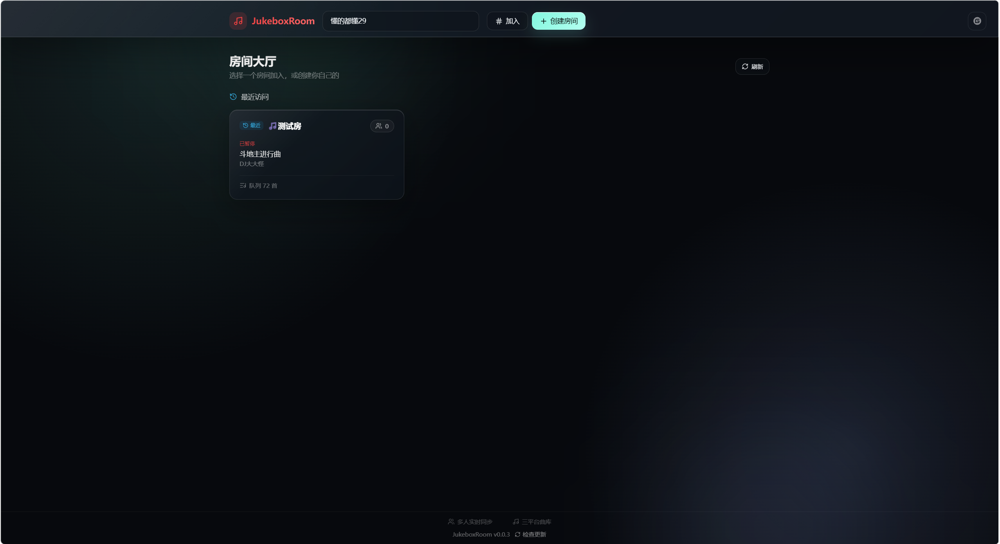
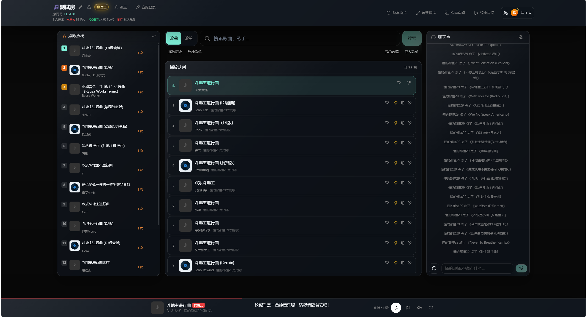
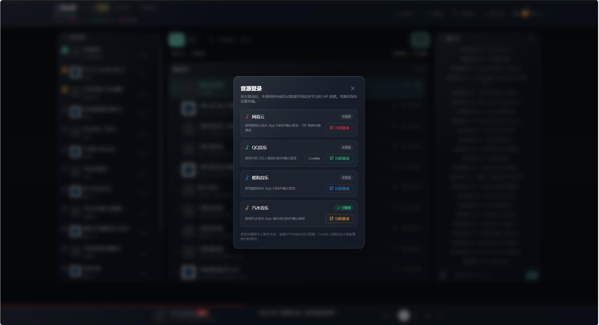

# JukeboxRoom · 多人实时在线点歌系统

[](LICENSE)


一群人聚在一起听歌，最怕的就是"放什么"争不出结果。JukeboxRoom 把选歌权交还给房间里的每一个人：大家各自搜歌、点歌、排队列，播放进度、歌词、聊天全部实时同步。

- 原创作者项目：<https://github.com/qq01-hub/openmusic>（本项目基于 OpenMusic 二次开发）
- 代码托管：GitHub <https://github.com/yuchen0x1/JukeboxRoom>

| 房间大厅 | 房间点歌与聊天 | 音源登录（房主专属） |
|:---:|:---:|:---:|
|  |  |  |

## 项目简介

JukeboxRoom 由 **Node.js 服务端**（Express + Socket.IO）和 **React Web 客户端**（Vite + TypeScript）组成，可直接私有部署。用户创建或加入音乐房间后，共享播放队列、播放进度和歌词，并在房间内聊天；服务端同时负责音乐源适配、媒体代理、房间管理、可选持久化和管理类接口。

典型场景：私人聚会、线上陪伴听歌、小型直播点歌、办公室/宿舍共享歌单、TV 大屏展示。项目处于正常维护与持续更新中。

## 核心特性

**房间与社交**

- 房间大厅、6 位房间号、房间密码、在线人数、分享链接、断线重连；
- 房间内聊天：文本、QQ 表情、本地/微信表情包入口、消息回复、@ 提及、消息回应，以及可选的七牛云图片上传。

**播放与音乐**

- 基于 Socket.IO 的实时同步播放：播放状态、队列和进度全房同步，支持暂停/播放/拖动进度；
- 音乐搜索与播放：网易云、QQ音乐、酷狗音乐、汽水音乐四平台聚合搜索，支持音质选择（如 Hi-Res、无损 FLAC）；
- **音源登录（房主专属）**：房主在「音源登录」面板扫码/授权登录网易云、QQ音乐、酷狗音乐、汽水音乐，全房成员点歌即使用该账号的 VIP / 高品质音源；凭据仅存服务端；
- 歌单与收藏：网易云热榜、歌单搜索、外部歌单导入、个人收藏；
- 歌词滚动与逐字高亮（卡拉OK 效果）、封面背景、Mini Player、同源媒体代理；
- 队列为空时可自动随机推荐（私人漫游）。

**房主管理**

- 房间改名、锁定、公告、全员禁言、踢人、成员等级、贵宾/管理员角色、点歌规则和 FM 模式。

**视觉与展示**

- 多种视觉模式：默认背景、唱片、封面、星河、声波地形、沉浸模式和纯净模式；
- TV 大屏：访问 `/tv/:roomId` 使用大屏播放界面。

**平台能力**

- 平台账号登录（`/login`）、个人收藏与共享歌单；
- 本地曲库：读取音频内嵌标签（失败时回退文件名），可选跨平台目录监听，文件增删改自动刷新索引；
- AutoDJ：活动时间段内队列低水位自动补歌，按歌曲/歌手去重；
- 在线更新检测：仅读取 GitHub 最新稳定 Release，Web/PWA/Capacitor 客户端展示更新提示；
- PWA、SEO 文件（robots.txt / sitemap.xml）、可选 Prometheus 指标（`/metrics`）、音乐源失败熔断与接口限流。

> 说明：服务端已内置认证、管理员、曲库、AutoDJ、任务中心和审计日志 API（按角色鉴权），但当前 Web 客户端仅提供首页、登录页、房间页和 TV 页，没有对应的管理后台界面。

## 技术栈

| 层 | 技术 |
|---|---|
| 服务端 | Node.js ≥ 20、Express 5、Socket.IO 4、Redis（可选） |
| 客户端 | React 19、Vite、TypeScript、Zustand、Tailwind CSS、React Router |
| 3D / 视觉 | Three.js、@react-three/fiber、MediaPipe Tasks Vision |
| 移动端 | Capacitor 7（Android / iOS 远程 URL 模式） |
| 音乐服务 | Meting-API（必需）；迟言 API（可选） |
| 对象存储 | 七牛云 OSS（可选，用于聊天图片） |

## 🚀 快速部署

### 方式一：AI 一键部署（推荐，复制下面的提示词发给任意 AI 编程助手）

把服务器 SSH 信息交给 AI 工具（如 ZCode / Claude Code / Cursor），粘贴这段提示词即可自动完成部署：

```text
请帮我在这台服务器上部署 JukeboxRoom 多人在线点歌系统（Node.js ≥ 20）：

1. 安装 Node.js 20（没有的话用 nvm 或系统包管理器安装）
2. 克隆仓库：git clone https://github.com/yuchen0x1/JukeboxRoom.git 并进入目录
3. 安装网页服务依赖：npm run install:web（根目录、server、client；桌面版依赖仅在构建桌面版时安装）
4. 创建 server/.env，内容包含：
   NODE_ENV=production
   CLIENT_ID_SECRET=<随机生成一段至少 32 个字符的密钥>
   AUTH_JWT_SECRET=<再随机生成一段不同的至少 32 个字符的密钥>
   METING_API_URL=https://api.injahow.cn/meting
   METING_SEARCH_API_URL=https://api.i-meto.com/meting/api
   （如绑定域名对外服务，再补 CLIENT_URL=https://你的域名 和 TRUST_PROXY=1）
5. 构建前端：进入 client 目录执行 npm run build
6. 启动服务：进入 server 目录用 pm2（npm i -g pm2 && pm2 start index.js --name jukeboxroom）或 systemd 常驻运行 node index.js，默认端口 4000
7. 自检：curl http://127.0.0.1:4000/api/health 应返回 ok
8. 最后告诉我访问地址（http://服务器IP:4000）、如何修改端口、如何更新版本（git pull 后重新 build + pm2 restart）

遇到报错请自行排查修复后再继续，不要中途停下来问我。
```

> AI 部署完成后记得：为 `CLIENT_ID_SECRET` 和 `AUTH_JWT_SECRET` 分别设置不同的、至少 32 个字符的随机值；在「音源登录」面板登录各平台音源。

### 方式二：Docker 一条命令

```bash
docker compose up -d --build
```

访问 `http://服务器IP:4000`。房间数据持久化在 `./data`，生产请修改 compose 里的 `CLIENT_ID_SECRET` 和 `AUTH_JWT_SECRET`。详细说明见 [docs/DEPLOY.md](docs/DEPLOY.md)。

### 方式三：Windows 桌面版（开箱即用）

从 GitHub [发布页](https://github.com/yuchen0x1/JukeboxRoom/releases) 下载 Windows 正式安装程序（`jukeboxroom-desktop-setup-*.exe`），运行安装向导后即可从桌面或开始菜单启动 JukeboxRoom。桌面版是独立 App，内置本地服务端和完整页面，无需另行安装 Node.js。首次运行若出现 Windows SmartScreen 提示，请核对下载来源为本项目 GitHub Release；当前构建未使用商业代码签名证书。

### 本地开发

```bash
git clone https://github.com/yuchen0x1/JukeboxRoom.git
cd JukeboxRoom
npm run install:web   # 网页服务：根目录、server、client；桌面版另行安装 desktop 依赖
npm run dev           # 同时启动服务端(4000)和前端(5173)
```

更详细的手动部署、Nginx 反代、Redis 持久化和故障排查见 **[docs/DEPLOY.md](docs/DEPLOY.md)**。

## 系统要求

- Node.js 20 或更高版本（服务端 `engines` 要求 `>=20`），npm；
- Docker / Docker Compose（可选，用于运行仓库提供的 Meting-API 示例）；
- Redis（生产环境推荐；不配置时使用内存 + 本地 JSON 存储）；
- 构建移动端需要 Android Studio / Xcode 及 Capacitor 工具链。

## 快速开始

以下 4 步可以在本机跑起完整开发环境。

### 第 1 步：克隆并安装依赖

```bash
git clone https://github.com/yuchen0x1/JukeboxRoom.git
cd JukeboxRoom
npm run install:web   # 网页服务：根目录、server、client；桌面版另行安装 desktop 依赖
```

### 第 2 步：启动 Meting-API

网易云和 QQ 的播放、歌词、封面、歌单搜索与导入都依赖 Meting-API。仓库自带自托管示例（把容器 3000 端口映射到宿主机 **3300**）：

```bash
docker compose -f deploy/docker-compose.meting.yml up -d
```

服务端地址填 `http://127.0.0.1:3300`。需要配置平台 Cookie 时，按 `deploy/docker-compose.meting.yml` 中的注释补充环境变量。

> 服务端默认拒绝访问本机、私有和保留地址，本机自托管 Meting 必须设置 `ALLOW_PRIVATE_UPSTREAMS=1`（见下一步）。生产环境优先使用可校验证书的 HTTPS 上游。

### 第 3 步：写好服务端配置

Linux / macOS：

```bash
cp server/.env.example server/.env
```

Windows PowerShell：

```powershell
Copy-Item server/.env.example server/.env
```

开发环境最小配置示例：

```env
PORT=4000
CLIENT_URL=http://localhost:5173
# 非生产环境可留空：服务端会在 server/data/.secrets.json 持久化随机回退值
CLIENT_ID_SECRET=
AUTH_JWT_SECRET=
METING_API_URL=http://127.0.0.1:3300
ALLOW_PRIVATE_UPSTREAMS=1
METING_API_AUTH=
```

### 第 4 步：启动开发环境

```bash
npm run dev
```

- 服务端：<http://localhost:4000>
- Vite 前端：<http://localhost:5173>（已配置代理转发 `/api` 和 `/socket.io` 到 4000 端口）

打开前端地址，创建房间、搜索歌曲并把歌加入队列，即可开始使用。

## 生产部署

### 单 Node 进程

生产环境由同一个 Node 进程提供 API、WebSocket 和 `client/dist` 静态资源：

```bash
npm run install:web
npm run build
cp server/.env.example server/.env
# 编辑 server/.env：设置 NODE_ENV=production 及生产必填项
npm run start
```

使用 PM2 时可直接引用仓库配置（单实例，内存超限自动重启）：

```bash
pm2 start deploy/ecosystem.config.cjs
```

更多细节（宝塔面板部署等）见 [`deploy/DEPLOY-BAOTA.md`](deploy/DEPLOY-BAOTA.md) 和 [`docs/DEPLOY.md`](docs/DEPLOY.md)。

### Nginx 反向代理

必须为 `/socket.io/` 配置 WebSocket 升级，否则房间无法实时同步。可直接参考 [`deploy/nginx.conf.example`](deploy/nginx.conf.example)；使用反向代理时按实际情况设置 `TRUST_PROXY=1`，并确保 Nginx 正确覆盖 `X-Forwarded-For`。

### Redis 与数据持久化

- 未配置 Redis 时，房间等状态保存在进程内存和本地 JSON 文件中（默认目录 `server/data`，可用 `OPENMUSIC_DATA_DIR` 指到独立数据盘），**重启会丢失易变状态**；
- 生产环境建议配置 `REDIS_URL`（或分项变量），同时保持**单实例运行**——在没有共享状态方案前，多进程会导致房间状态不一致；
- 升级或备份时只覆盖代码目录，不要删除数据目录。

### 关于 Docker

仓库仅提供 Meting-API 的 Docker Compose 示例，**不包含** JukeboxRoom 主服务的 Dockerfile 或完整应用 Compose 文件。主服务请使用 Node/PM2、宝塔或自行制作容器镜像部署。

## 环境变量参考

所有服务端配置从 `server/.env` 读取，完整变量模板见 [`server/.env.example`](server/.env.example)。生产环境必须设置 `NODE_ENV=production`，并使用稳定且足够长的随机密钥。

**基础与安全**

| 变量 | 默认 | 说明 |
|---|---|---|
| `PORT` | `4000` | 服务端口（HTTP 与 WebSocket 同端口） |
| `NODE_ENV` | — | 生产环境设为 `production` |
| `CLIENT_URL` | — | 生产必填。允许的前端 Origin，多个用英文逗号分隔，不带末尾斜杠 |
| `CLIENT_ID_SECRET` | 非生产自动生成 | 生产必填；至少 32 个字符、不能是占位符，浏览器会话 ID 签名密钥，重启后不要变化 |
| `AUTH_JWT_SECRET` | 非生产自动生成 | 生产必填；至少 32 个字符、不能是占位符，平台账号 JWT 签名密钥，重启后不要变化；非生产回退值保存在被忽略的 `server/data/.secrets.json` |
| `AUTH_ACCESS_TTL` | `86400000` | 访问令牌有效期（毫秒） |
| `AUTH_REFRESH_TTL` | `2592000000` | 刷新令牌有效期（毫秒，默认 30 天）；刷新令牌轮换且只能使用一次 |
| `MAX_CONCURRENT_SOCKETS_PER_IP` | `50` | 单 IP 同时在线 Socket 数上限（进程内） |
| `TRUST_PROXY` | 关闭 | Nginx 正确覆盖转发头时设为 `1`，用于获取真实客户端 IP |
| `OPENMUSIC_DATA_DIR` | `server/data` | JSON 持久化目录，可指向独立数据盘 |

**音乐源**

| 变量 | 默认 | 说明 |
|---|---|---|
| `METING_API_URL` | — | 推荐配置。Meting-API 地址，公网优先 HTTPS；仓库 Compose 示例为 `http://127.0.0.1:3300` |
| `METING_API_AUTH` | — | 推荐配置。Meting-API 鉴权令牌 |
| `ALLOW_PRIVATE_UPSTREAMS` | 关闭 | 设为 `1` 仅允许配置的 Meting 主机访问私有地址（仅限本机/内网自托管，不会放宽媒体代理或用户可控 URL） |
| `CYAPI_BASE` | `https://cyapi.top/API` | 迟言 API 根地址 |
| `CYAPI_KEY` | — | 可选：迟言 API（酷狗第三方源）；酷狗搜索现已默认走官方网页接口，无需此项 |
| `VMY_LRC_URL` | `https://api.52vmy.cn/api/music/lrc` | 按歌名的歌词备用接口 |

**Redis（可选）**

| 变量 | 说明 |
|---|---|
| `REDIS_URL` | 连接串方式，如 `redis://127.0.0.1:6379/0` |
| `REDIS_HOST` / `REDIS_PORT` / `REDIS_USERNAME` / `REDIS_PASSWORD` / `REDIS_DB` | 分项配置方式，与 `REDIS_URL` 二选一 |

**本地曲库**

| 变量 | 默认 | 说明 |
|---|---|---|
| `MUSIC_LIBRARY_PATHS` | — | 曲库目录，多个用分号分隔 |
| `LIBRARY_WATCH_ENABLED` | 关闭 | 设为 `1` 监听曲库文件变化并自动刷新索引 |

**AutoDJ**

| 变量 | 默认 | 说明 |
|---|---|---|
| `AUTODJ_ENABLED` | 关闭 | 设为 `1` 开启 |
| `AUTODJ_ACTIVE_HOURS` | — | 活动时间段，如 `9-23` |
| `AUTODJ_AVOID_SAME_SONG` | `3` | 同歌曲去重窗口（首） |
| `AUTODJ_AVOID_SAME_ARTIST` | `2` | 同歌手去重窗口（首） |
| `AUTODJ_LOW_WATER` | `5` | 队列低水位阈值（首） |

**媒体熔断**

| 变量 | 默认 | 说明 |
|---|---|---|
| `MEDIA_HEALTH_FAILURE_THRESHOLD` | `5` | 连续失败阈值，触发短时熔断 |
| `MEDIA_HEALTH_FAILURE_WINDOW_MS` | `60000` | 失败统计窗口（毫秒） |
| `MEDIA_HEALTH_COOLDOWN_MS` | `30000` | 熔断冷却时长（毫秒），冷却后自动恢复探测 |

**七牛云（聊天图片，可选）**

| 变量 | 说明 |
|---|---|
| `QINIU_ACCESS_KEY` / `QINIU_SECRET_KEY` | 上传凭据 |
| `QINIU_BUCKET` / `QINIU_DOMAIN` / `QINIU_ZONE` | 存储桶、访问域名、区域（`z0` 华东、`z1` 华北、`z2` 华南、`na0` 北美、`as0` 东南亚） |

**其他**

| 变量 | 默认 | 说明 |
|---|---|---|
| `APIHZ_IMG_ID` / `APIHZ_IMG_KEY` | — | 接口盒子表情包搜索凭据（不配置则隐藏搜索入口） |
| `METRICS_ENABLED` | 关闭 | 设为 `1` 开启 `/metrics` |
| `METRICS_TOKEN` | — | `/metrics` 访问令牌，生产环境不要开放无保护指标 |
| `UPDATE_REPOSITORY` | `yuchen0x1/JukeboxRoom` | 在线更新检查的 GitHub 仓库 |
| `UPDATE_GITHUB_TOKEN` | — | GitHub API 限流时填写只读令牌 |
| `TASK_AUDIT_RETENTION_DAYS` | `90` | 任务审计保留天数 |
| `TASK_RUNS_KEEP` | `500` | 任务运行记录数量上限 |

## 使用指南

### 网页端

1. 打开首页点击"创建房间"，可填写房间名和密码；
2. 把 6 位房间号或分享链接发给其他成员；
3. 搜索歌曲或歌单，点击加入播放队列；
4. 在聊天室发送文本、表情或图片，可以回复、@ 提及和回应消息；
5. 房主在房间设置中调整点歌限制、公告、视觉背景、成员权限、音质和 FM 模式；
6. 大屏展示访问 `https://你的域名/tv/房间号`。

### 桌面版（Windows .exe）

独立桌面客户端，双击即用：内置本地服务端和完整页面，**无需安装 Node.js**，窗口关闭时本地服务随之退出。

- 首次启动会在 `%APPDATA%\JukeboxRoom\jukeboxroom.env`（或升级时沿用既有 `%APPDATA%\openmusic-desktop` / `%APPDATA%\OpenMusic`）自动生成配置模板和随机安全密钥；搜歌/播放依赖 Meting-API，按模板注释填写 `METING_API_URL` 后重启生效；
- 房间、收藏等本地数据保存在上述用户数据目录下的 `data`；卸载安装程序不会删除配置和数据；
- 构建：`npm run desktop:build`（先构建前端，再只生成 `release/desktop/jukeboxroom-desktop-setup-<版本>-x64.exe` 正式安装程序）；
- 当前 Windows 构建未使用商业代码签名证书，首次运行可能显示 SmartScreen 提示；发布前请确认文件来自项目 GitHub Release。

### 手机 App（Android）

Android 版是独立的个人音乐播放器，不需要填写 JukeboxRoom 服务器地址，也不依赖多人房间服务。应用直接通过互联网搜索和播放网易云音乐、QQ 音乐等平台的可用曲目，并在设备本地保存收藏、歌单、播放历史和队列；可使用系统媒体通知、锁屏控制和耳机按键继续播放。音乐平台的接口与音源可用性仍由对应服务提供方决定。

构建 Android 调试 APK：

```bash
# Android debug（开发安装）
npm run cap:run:android     # 或分步执行 cap:sync:android + cap:open:android
npm run cap:build:apk

# Android release（本地签名）
npm run cap:build:apk:release --prefix client
```

Release 构建前需在 `client/android/keystore.properties` 配置本机 keystore（文件已忽略，不要提交），或设置 `ANDROID_KEYSTORE_FILE`、`ANDROID_KEYSTORE_PASSWORD`、`ANDROID_KEY_ALIAS`、`ANDROID_KEY_PASSWORD` 环境变量。`com.openmusic.app` applicationId 保持不变以便沿用安装身份；若本机没有旧版签名证书，新 APK 无法覆盖安装在其他证书下签名的旧版，必须先卸载旧版（本地数据可能被删除）。iOS 本次仍使用现有客户端，不包含独立音乐播放器改版。

## 接口概览

常用 HTTP 接口（完整路由以 `server/index.js` 及各路由模块为准）：

| 模块 | 接口 |
|---|---|
| 健康检查 | `GET /api/health`、`GET /api/health/live`、`GET /api/health/ready` |
| 版本更新 | `GET /api/update`（读取 GitHub 最新稳定版，含桌面/Android/iOS 资产） |
| 房间 | `GET / POST /api/rooms`、`GET /api/rooms/:id` |
| 音乐 | `GET /api/music/sources`、`GET /api/music/health`、`GET /api/music/hot`、`GET /api/music/toplist/netease`、`GET /api/music/netease/playlists/search`、`POST /api/music/playlist/import` |
| 媒体 | `GET /api/media-proxy?url=...`（同源媒体代理） |
| 聊天 | `GET /api/chat/sticker-search`、`POST /api/chat/upload-token`（需对应凭据） |
| 扩展模块 | `/api/auth/...`、`/api/admin/...`、`/api/library/...`、`/api/autodj/...`、`/api/playlists/...`（均需角色鉴权） |
| 客户端分发 | `GET /downloads/openmusic.apk`、`/downloads/openmusic.ipa`、`/downloads/jukeboxroom-desktop.exe` |

WebSocket 与 HTTP 使用同一端口，连接路径 `/socket.io`。常用事件：

- 客户端 → 服务端：`join_room`、`add_song`、`toggle_play`、`seek`、`send_chat`、`toggle_chat_reaction`
- 服务端 → 客户端：`room_update`、`playback_state`、`chat_message`

快速验证：

```bash
curl http://localhost:4000/api/health
curl http://localhost:4000/api/music/sources
```

## 项目结构

```text
.
├── client/                 # React + Vite + TypeScript 前端
│   ├── src/pages/          # Home / Login / Room / TvDisplay 四个路由页面
│   ├── src/components/     # 播放器、聊天、队列、galaxy/topography/immersive 视觉、tv 等组件
│   ├── src/stores/         # Zustand 状态（房间、聊天、音频、纯净/沉浸模式等）
│   ├── public/             # PWA manifest、Service Worker、表情资源
│   ├── android/  ios/      # Capacitor 原生工程
│   └── scripts/            # Capacitor 同步与 APK 打包脚本
├── server/                 # Express + Socket.IO 服务端
│   ├── auth/  admin/       # 认证与管理接口
│   ├── library/  autodj/   # 本地曲库与 AutoDJ
│   ├── playlists/  tasks/  # 共享歌单与任务中心
│   ├── audit/  db/  data/  # 审计日志、存储适配、本地 JSON 数据目录
│   └── *.test.js           # Node 内置测试运行器的测试文件
├── deploy/                 # Meting Compose、PM2、Nginx 示例与宝塔部署文档
├── desktop/                # Electron 桌面壳（Windows 独立 .exe，内置本地服务端）
├── docs/                   # 部署文档与项目截图
├── scripts/                # 健康检查、打包与视觉资源脚本
├── .github/workflows/      # CI 工作流
├── CHANGELOG.md            # 版本变更记录
└── LICENSE                 # MIT License
```

## 测试与质量检查

```bash
npm test            # 运行全部测试（服务端 + 客户端）
npm test --prefix server   # 仅服务端（Node 内置 test runner）
npm test --prefix client   # 仅客户端（Vitest）
npm run build       # TypeScript 类型检查 + 生成 client/dist
npm run check       # 全量检查：测试 + 构建 + 生产依赖安全审计
npm run check:health       # 对已启动实例做存活/就绪/更新接口冒烟检查
```

`check:health` 默认检查 `http://127.0.0.1:4000`，可用 `OPENMUSIC_URL` 指向其他实例，`OPENMUSIC_SKIP_UPDATE=1` 跳过外部更新源检查。

### Windows 桌面版构建

在 Windows 环境安装网页依赖和桌面端依赖后构建：

```bash
npm run install:web
npm install --prefix desktop
npm run desktop:build
```

NSIS 安装程序输出到 `release/desktop/`。Android 与 iOS 安装包需分别在对应平台工具链中构建；当前 GitHub Release 提供的安装资产以实际发布页为准。

## 常见问题排查

**页面能打开，但进不了房间**
检查 Nginx 是否配置了 `/socket.io/` 的 WebSocket 升级，并确认 `CLIENT_URL` 与访问域名一致。

**搜不到歌或无法播放**
检查 `METING_API_URL`、Meting 服务状态及 `METING_API_AUTH`；酷狗无需额外配置（房主登录酷狗后可用 VIP 音源）。

**酷狗音乐播放卡顿**
为 `/api/media-proxy` 关闭 Nginx 缓冲，见 `deploy/nginx.conf.example`。

**生产启动后跨域失败**
`NODE_ENV=production` 时必须配置正确的 `CLIENT_URL`，多个 Origin 用英文逗号分隔。

**出现 502 或服务不可用**
检查 `npm run start` / PM2 是否运行、端口是否与 Nginx 反代端口一致。

**服务重启后房间消失**
未配置 Redis 时属于预期行为；生产环境配置 `REDIS_URL` 或 Redis 分项变量。

**聊天发不了图片**
配置七牛云相关变量；未配置时图片上传能力会被禁用。

**移动端打不开线上页面**
检查 `client/.env.capacitor` 中的 `CAPACITOR_SERVER_URL` 是否为可访问的 HTTPS 地址。

## 安全注意事项

- 生产环境必须使用 HTTPS，并设置稳定、随机的 `CLIENT_ID_SECRET` 和 `AUTH_JWT_SECRET`；
- 不要将 `.env`、Redis 凭据、七牛云密钥或第三方 API Key 提交到公开仓库；
- 媒体代理只允许 `http`/`https` URL，并拒绝本机、环回、私有和保留地址，不要把它当作任意内网访问代理；
- Nginx 必须正确转发 `X-Forwarded-For` / `X-Real-IP`，否则限流和 IP 识别可能不准确；
- 多实例部署需要先设计共享状态和一致性方案，当前请保持单实例；
- Meting-API、迟言 API 和七牛云均为第三方服务，请遵守其服务条款、版权和内容使用要求。

## 版本

当前版本 `0.0.7`，变更记录见 [`CHANGELOG.md`](CHANGELOG.md)。服务端启动后会读取 GitHub 最新稳定 Release 提供更新检测（`GET /api/update`），源码、Release 与 Issue 统一托管在 [github.com/yuchen0x1/JukeboxRoom](https://github.com/yuchen0x1/JukeboxRoom)。

## 参与贡献

欢迎通过 GitHub 的 Issue 或 Pull Request 提交 Bug、改进建议和代码。提交前请至少运行：

```bash
npm test
npm run build
```

涉及服务端请求 URL、媒体代理或第三方接口的改动，请同时检查 URL 协议、主机校验、超时和错误处理。

## License

本项目基于 [MIT License](LICENSE) 开源。

## 交流与反馈

- QQ 交流群：`1016190748`
- Telegram：<https://t.me/lenmoC>

反馈问题时请说明使用的版本、运行平台、部署方式和具体错误信息，以便更快定位。
