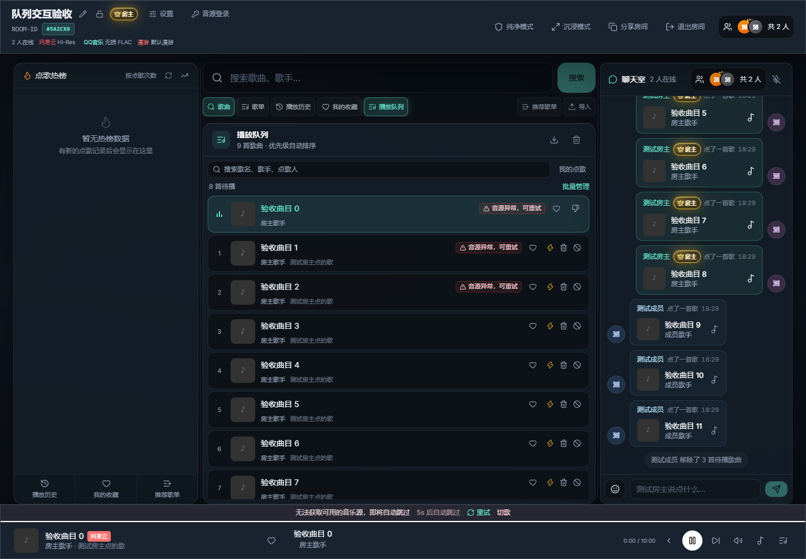
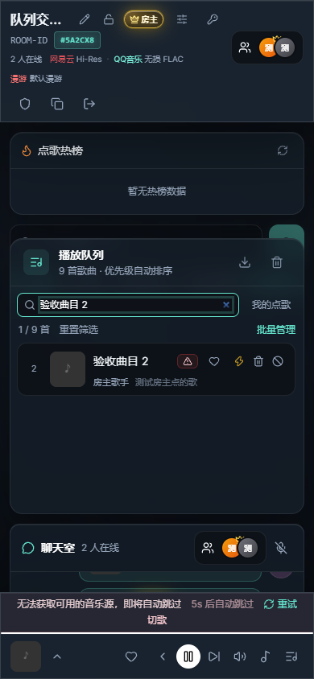

# JukeboxRoom 自主研究与升级交付报告

日期：2026-11-13（Asia/Shanghai）。基线：`main` / `c8100ca` / v0.0.17；开始时工作区干净，`main` 跟踪 GitHub `origin/main`。本次仅本地修改，未提交、推送、发版或部署，产品版本号保持不变。

> 历史记录说明：下文的基线、测试数字和阻塞项保留自最初实施时的快照。后续提交前已基于当前代码重新验证，结果见文末；提交、推送与 CI 状态以 Git 历史和 GitHub Actions 为准。

## 1. 项目定位与功能地图

项目是自托管多人点歌系统，包含 React 19 / TypeScript / Vite / Zustand Web 客户端，Express 5 / Socket.IO 服务端，Electron Windows 壳及 Capacitor 移动工程。Windows 独立播放器、Android 独立播放器和多人房间是不同产品路径，本轮变更针对 Web 房间和服务端共享歌单。

| 模块 | 实际入口和代码 | 已有能力 / 本轮检查边界 |
|---|---|---|
| 大厅、房间 | `client/src/pages/Home.tsx`、`Room.tsx`、`server/index.js` | 创建/加入、密码、身份 Cookie、成员角色、断线重连；本轮实际验证双会话创建/加入 |
| 共享队列与同步 | `roomManager.js`、`useSocket.ts`、`QueuePanel.tsx` | 点歌、点赞、插队、播放时钟、权限；本轮贯通 UI → Socket → 状态修改 → 跨用户广播 |
| 音源和音频 | `sourceResolvers.js`、`metingFetch.js`、`mediaProxyPolicy.js`、客户端音频模块 | 多源解析、登录、代理、失败回退；本轮运行既有回归，未做真实账号/音源实播 |
| 聊天与管理 | `roomManager.js`、`auth/`、`admin/` | 文本/图片/回复/表情、角色、审计；新增批量移除复用既有系统消息 |
| JSON 与 Redis | `db/store.js`、`roomStorage.js` | JSON 文件锁/备份、可选 Redis；本轮不迁移数据、不连接用户 Redis |
| 共享歌单 API | `server/playlists/index.js` | CRUD、协作者、版本冲突、重排；本轮修复重排数据丢失缺陷 |
| 本地曲库、AutoDJ、任务 | `library/`、`autodj/`、`tasks/` | 曲库流式读取、补歌、后台任务和审计；回归测试覆盖，不新增平行业务 |
| 多端与发布 | `desktop/`、`client/android`、`.github/workflows` | Windows 包装/更新、Android、Web 构建；本轮不重打安装包、不验证真实更新安装 |

阅读了上述关键入口、状态修改、权限、存储与测试代码；这不是逐行审阅全部源文件，也不是完整渗透测试。既有审计文档仅作线索，未沿用旧测试数字。

## 2. 审计发现、优先级与实施取舍

| 优先级 | 发现 / 用户价值 | 难度、风险与决定 |
|---|---|---|
| P0 | 重排 `[a,b] → [a,a]` 原先通过校验，写盘后丢失 b；Map 还会合并历史重复 ID 条目 | 小范围修复：按 ID 出现次数验证精确排列，保留每个原始条目；无迁移，立即实施 |
| P0 | 部分现有测试直接导入默认 JSON store，并用全量清理函数处理运行数据 | 新测试入口强制独立数据目录，覆盖外部传入路径并禁用 Redis；成功/失败清理均有独立回归，立即实施 |
| P1 | 长队列只能逐行查找，没有定位自己点歌的入口 | 本地搜索和我的点歌筛选，沿用原始队列及虚拟列表；不增加服务器请求和新依赖 |
| P1 | 删除失败返回值被 UI 丢弃，成员看不到超时/权限/歌曲过期原因 | 新路径保留结构化错误，在队列内提示；旧 `removeSong` 方法及 `remove_song` 协议保留 |
| P1 | 多首撤回需要重复操作和广播 | 新 `remove_songs` 事件一次校验并修改；确认后才执行，整批拒绝非法/过期选择，不中断当前播放 |
| P2 | 小屏音源错误标签挤占歌名，提示定时器未清理、会互相覆盖 | 窄屏图标和辅助说明、最新消息计时器清理、减少动态效果偏好；已实施 |
| P2 | README 称卸载会删用户数据，与 NSIS `deleteAppDataOnUninstall: false` 不符 | 据实际配置修正文档；未安装/卸载实际软件 |
| P2/P3 | 多实例状态一致性、共享歌单多次文件操作的跨进程事务、条目 ID 消歧仍需设计 | 本轮不扩大为数据库/协议重构；需专门迁移与并发验收，列入后续 |

### 本次基线执行涉及运行数据的事件

第一次执行 `npm run test:all` 前，未先确认旧测试的数据隔离。该次运行后确认 `server/data` 下多个集合及 `.bak` 文件时间发生变化；例如歌单、曲库、AutoDJ 和任务快照的旧测试使用了集合清理。**没有运行前快照，无法确认原有数据是否丢失，也不能声称数据未受影响。**

发现后没有删除或恢复这些运行文件，没有用 `.bak` 覆盖现状；备份也可能已经被旧测试轮换，不能直接视作原始数据。此事件属于本次执行的局限，不能用后来测试通过来抵消。

仅在本项目内做了只读备份文件清单检查：`server/data_quarantine/` 和 `server/data_quarantine2/` 存在 2026-11-02/03 的历史 `.bak`/JSON 文件。只核实了文件名、大小和时间，未读取敏感记录、未移动、未恢复；它们早于本轮运行，但不足以证明可以完整恢复 11 月 13 日之前的状态。

随后新增的隔离入口已通过两类证据验证：① 传入一个含哨兵记录的“原始数据目录”，即使测试成功或故意失败，该记录仍完全保留，独立临时目录清理完成；② 再跑完整回归前后，实际 `server/data` 文件清单和 SHA-256 一致。后一项只证明修复后的回归没有继续改写数据。

## 3. 5 个开源/源码公开项目研究

在线查阅各仓库 README、代码树、下列核心实现，并检查仓库元数据、最新 Release 列表和少量开放 Issue/PR；没有运行第三方仓库代码，也没有复制或引入其代码。最后推送日期为 GitHub API 在本次读取时返回的 UTC 日期，不能等同于维护质量。

| 项目 / 定位 | 阅读证据 | 维护/许可 | 实际借鉴与边界 |
|---|---|---|---|
| [CrowdRoom](https://github.com/jaherhum/crowdroom)，协作点歌 | [队列服务](https://github.com/jaherhum/crowdroom/blob/main/backend/services/queue_service.py)、README、队列/房间目录 | 最后推送 2026-10-28；Release v0.1.1；AGPL-3.0 | 原子写入、活动播放状态与队列广播分离。应用到“先完整验证批次，再改队列，广播一次”；不引入 Spotify adapter 栈 |
| [Jukeplox](https://github.com/DJRkod/jukeplox)，本地媒体库/投放音箱 | [队列引擎](https://github.com/DJRkod/jukeplox/blob/main/app/queue/engine.py)、README、库/测试目录 | 最后推送 2026-11-11；Release 列表为空；GPL-2.0 | 批处理容量检查、锁与单次事件。借鉴批次全部成功或全部拒绝；Linux 音箱发现不适合直接移植到 Windows 房间 |
| [CueVote](https://github.com/zienert/cuevote)，社区投票队列 | [排序实现](https://github.com/zienert/cuevote/blob/main/cuevote-server/queue-order.js)、README、队列 UI/测试树 | 最后推送 2026-11-12；Release v1.0.7；PolyForm Noncommercial 1.0.0 | 明确保护当前播放、房主优先和稳定投票排序。本项目已有这些机制，新增筛选只作用于视图，不重排服务器队列。该许可证有限制，因此仅作设计参考，不把它称作 OSI 开源 |
| [Jukebox](https://github.com/skeptrunedev/jukebox)，免账号协作播放 | [交互歌曲表](https://github.com/skeptrunedev/jukebox/blob/main/frontend/src/components/InteractiveSongTable.tsx)、README、server/frontend 树 | 最后推送 2025-07-11；Release 列表为空；MIT | 直接操作队列、键盘交互、移动可用。实现原生键盘可用搜索/勾选/确认；其手动拖拽排序会与本项目点赞优先级冲突，未移植 |
| [Syncplay](https://github.com/Syncplay/syncplay)，多播放器同步 | [协议实现](https://github.com/Syncplay/syncplay/blob/master/syncplay/protocols.py)、README、资源/播放器树 | 最后推送 2026-10-12；Release v1.7.6；Apache-2.0（默认） | 状态/播放列表同步边界和重新连接初始化。新增管理操作沿用服务器权威状态；未修改同步算法，不宣称声学相位一致 |

Issue/PR 抽样反映了隐私一致性、部署兼容、队列插入和平台访问限制等真实维护成本。例如 [CrowdRoom 隐私校验问题](https://github.com/jaherhum/crowdroom/issues/152)、[Jukebox 队列插入修复 PR](https://github.com/skeptrunedev/jukebox/pull/17)。这些条目是调研资料，并不表示本项目也必然存在相同问题。

| 对比维度 | 当前项目原状 | 竞品实践 / 差距 | 本轮决定 |
|---|---|---|---|
| 核心功能 | 多音源、聊天、投票、AutoDJ 已有 | 更多功能数量不代表收益 | 保持原技术栈和业务路径 |
| UI/UX | 虚拟列表已有，队列难定位/撤回 | 直接队列操作、移动交互 | 搜索、我的点歌、多选、确认、失败反馈 |
| 架构与一致性 | 当前播放独立存储，服务端权威 | 原子批次、保护正在播放 | 批量校验后一次修改，当前曲不进入选集 |
| 自动化/质量 | Node/Vitest/CI 已有，旧测试未隔离 | 可重复任务与测试 | 隔离测试、双浏览器会话 E2E 和截图 |
| 扩展性 | 既有提供方和多端边界复杂 | adapter/外部播放器 | 保留既有能力，暂不增加插件或服务 |

## 4. 本轮实现与兼容性

- 搜索支持歌名、歌手、专辑、点歌人，多词 AND 匹配、忽略大小写；筛选不改队列顺序，仍显示原始待播编号。
- 我的点歌优先按稳定用户 ID 匹配；仅无 ID 的历史条目回退昵称，沿用旧所有权规则。同名不同 ID 不视作本人。
- 多选只选择可管理的待播歌曲；筛选变化、权限变化或歌曲离开待播列表会修剪选择；全选作用于当前过滤结果。
- `remove_songs { queueIds }`：1–200 个 ID，每个为非空字符串且不超过 128 字符；重复 ID 去重。校验房间成员、只读状态、当前歌曲、过期 ID 和所有权后才修改。返回 `{ success, removed }` 或 `{ success: false, error }`，执行既有限流/只读守卫。
- 批量移除同步清除相应插队请求，持久化一次，发送一条系统消息并进行一次房间广播。当前播放对象、播放开关及未选歌曲不变。
- `remove_song` 保留，复用同一领域校验；UI 单曲删除使用新批次路径获得具体错误。没有添加数据库、应用运行依赖或 schema 版本。
- 共享歌单重排要求 ID 的多重集合精确匹配，保留既有重复 ID 的每条元数据；错误请求不改歌曲、版本或时间戳。跨进程读改写事务及单独编辑同 ID 条目的语义仍是后续课题。
- 设计沿用既有深色玻璃面板、CSS 色彩变量、字体和密度；新增两行紧凑工具区，不增加独立导航。搜索框、筛选和多选控件具备可访问名称与焦点反馈，结果提示使用 `role=status`。

## 5. 验证结果

环境：Windows、Node.js v24.20.0、npm 11.19.0；应用既有依赖已安装，没有重新执行整套 clean install。新增 Playwright 仅安装到忽略的 `.evolution/qa-tools/`，应用 package/lockfile 未增加该依赖。内置浏览器服务文件缺失；Python Playwright 安装遇 SSL 失败；最终使用 Playwright Node 包与系统 Edge 无头模式完成验收，参照 [官方浏览器通道文档](https://playwright.dev/docs/browsers#google-chrome--microsoft-edge)。

| 状态 | 命令/场景 | 结果 |
|---|---|---|
| PASS | `npm run test:all` | 隔离入口 2、服务端 138、客户端 37、桌面端 11 项；最终总计 188 项，0 失败 |
| PASS | `npm run build` | TypeScript + Vite 生产构建；Three.js 大 chunk 警告仍存在 |
| PASS | `npm run check:bundle` | 首页/房间/TV/管理页均在预算内，普通首屏不加载 3D 依赖 |
| PASS | `node scripts/check-queue-browser.mjs` | 隔离服务实际启动并通过 ready 探针；两个全新用户经 UI 创建/加入，实际 Socket 点歌、跨用户广播、权限/当前曲保护、搜索、我的点歌、确认/取消批量移除、过期重试拒绝 |
| PASS | Edge 1440×1000、390×844 | 桌面/手机搜索与空状态、无横向溢出、无未捕获 JS 错误；已检查实际截图 |
| PASS | `git diff --check` | 无差异空白错误 |
| PASS | npm 官方 registry 生产依赖 audit：根、client | 均报告 0 vulnerabilities；不代表安全渗透测试 |
| BLOCKED | npm 官方 registry 生产依赖 audit：server | 两次请求 `read ECONNRESET`，无法报告该目录无漏洞，`npm run check` 整体门禁未全绿 |
| PARTIAL | 数据安全 | 修复后测试前后运行数据哈希一致；首次基线运行前无快照，影响无法确认，见事件记录 |
| NOT APPLICABLE | 数据迁移 | 未改变 schema，未恢复/迁移用户数据 |
| BLOCKED | 第三方实播/正式设备/多实例 | 本轮未验证真实账号音乐播放、Redis 多实例、Android/iOS 真机、Windows 安装/卸载/升级、发布签名与远端 CI |

浏览器验收使用合成曲目元数据，通过真实应用协议加入临时房间；音源错误提示是该测试情境的真实运行结果，**这些截图不是实际外部曲库可用或音频播放成功的证据**。

本地日志位于 `.evolution/upgrade-tests-2026-11-13.log`、`build-2026-11-13.log`、`browser-check-2026-11-13.log` 和 audit 日志（未入 Git）。初始基线为 132/34/11；最终新增的是隔离 2、服务端 6、客户端 3 项。

## 6. 重要文件清单

| 文件 | 改动原因 |
|---|---|
| `client/src/components/QueuePanel.tsx` | 搜索、筛选、多选/确认、结果提示、虚拟列表与计时器 |
| `client/src/components/queue/QueueRow.tsx` | 选择框、稳定身份判断、窄屏错误标记 |
| `client/src/lib/queueView.ts`、`queueView.test.ts` | 可测试的过滤、所有权与选集逻辑 |
| `client/src/hooks/useSocket.ts` | 结构化批量移除响应，保留旧方法 |
| `server/roomManager.js`、`roomManager.queue.test.js` | 整批权限/状态校验、移除与领域回归 |
| `server/index.js` | Socket 协议入口、守卫、广播 |
| `server/playlists/index.js`、`playlists.test.js` | 精确排列校验与重复 ID 元数据保护回归 |
| `scripts/test-server.mjs`、`test-server.test.mjs` | 测试目录隔离与成功/失败保护验证 |
| `package.json`、`server/package.json`、`.gitignore` | 默认测试入口和本地临时工具/数据忽略规则 |
| `scripts/check-queue-browser.mjs`、`docs/screenshots/queue-management-*.png` | 可重复双用户浏览器验收和渲染证据 |
| `README.md`、`CHANGELOG.md`、本报告 | 真实待发布行为、操作步骤、证据和局限 |

没有删除项目文件，没有修改 AGENTS.md、用户配置或安装包，没有更换框架或引入第三方业务代码。运行数据事件按上文单独披露，不能将“没有主动编辑数据库”解释成“测试未触及数据库”。

## 7. 后续优先级与完成度

1. P0：由数据所有者根据独立历史备份核实首次基线影响；未经明确恢复授权，不覆盖现存文件。旧测试必须经隔离入口执行。
2. P1：在网络可用时重跑服务端生产依赖审计；将双用户 E2E 纳入带可用浏览器的 CI。当前只有本地证据，未触发远端工作流。
3. P1：真实音乐源登录/播放契约测试，以及桌面/Android 安装与升级验收；临时曲目测试不能替代。
4. P2：共享歌单提供每条 entry 的稳定独立 ID 和兼容迁移，建立完整跨进程事务；统一错误/撤回语义。
5. P2：Redis 双实例房间状态一致性、长时间断线重连、并发与资源压力验证；继续拆分大型页面和按需视觉资源。
6. P3：在核心路径证据充分后再考虑外部媒体库适配或插件系统，不盲目引入投放音箱基础设施。

不以缺乏量化基准的分数包装成熟度，以下完成度按本轮证据评估：

| 维度 | 证据结论 |
|---|---|
| 功能完整度 | 队列管理这条增量路径 PASS；整个多端产品 PARTIAL |
| UI/UX | 1440/390 两种视口 PASS；平板、触屏真机、完整无障碍审计 PARTIAL |
| 代码质量 | 188 测试及 TypeScript/构建 PASS；未全量逐行审计 |
| 性能 | 复用本地过滤与虚拟列表，包体预算 PASS；没有压力/延迟基准 |
| 安全性 | 新事件成员/权限/边界测试 PASS；服务端依赖审计 BLOCKED，未做渗透测试 |
| 稳定性 | 领域回归与双用户浏览器 PASS；首次运行数据影响未解决、外部服务和长稳未验证 |
| 可维护性 | 过滤/选择逻辑有独立模块和测试、测试入口隔离；大型房间页仍需渐进拆分 |
| 扩展性 | 旧 Socket 方法和持久化结构兼容；多实例/事务演进仍需专项设计 |

本轮交付的是经过本地验证的队列管理和数据保护增量，不能据此宣称全部平台已发布、安装更新已验证或产品所有问题已解决。

## 提交前复核（2026-11-13）

- PASS：`npm run check`，测试隔离 2 项、服务端 138 项、客户端 53 项、桌面端 11 项，共 204 项通过；TypeScript/Vite 构建和包体预算检查通过。
- PASS：根目录、服务端、客户端生产依赖审计均为 0 vulnerabilities；此次服务端审计已完成，解除最初记录中的网络阻塞，不等于完整安全审计。
- PASS：`node scripts/check-queue-browser.mjs`，真实双会话 HTTP/Socket.IO 验证搜索、权限、整批移除、跨用户广播、当前曲保护及失效重试，桌面与手机视口无未捕获页面错误。
- PASS：本次复核前后的 `server/data`、`server/data_quarantine` 和 `server/data_quarantine2` 共 52 个运行数据及备份文件的清单、SHA-256 一致。
- 本次数据一致性只覆盖此次复核，不能消除或推断最初基线执行的数据事件影响；未恢复、覆盖或迁移任何运行数据。
- 默认测试隔离回归已纳入 CI 与 Windows 发布前检查。本次仅提交源码、文档及合成曲目的验收截图，不创建新 Tag 或正式 Release。
